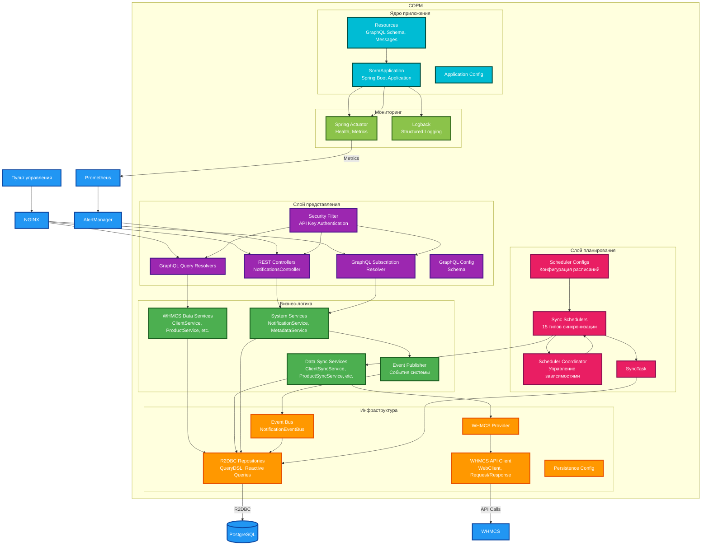

# СОРМ - Система оперативно-розыскных мероприятий

## Общее описание

**СОРМ** — это система, разработанная в соответствии с требованиями приказа Министерства цифрового развития, связи и
массовых коммуникаций РФ от 1 ноября 2023 г.
№935 ([Полный приказ](https://www.garant.ru/products/ipo/prime/doc/408010659)).
Система предназначена для интеграции с платформой автоматизации веб-хостинга [WHMCS](https://www.whmcs.com/)
и предоставления уполномоченным государственным органам доступа к данным провайдера хостинга в режиме реального времени.

### Основное назначение

- Сбор и синхронизация данных из WHMCS
- Предоставление GraphQL API для поиска и фильтрации данных
- Реализация подписок на события в реальном времени

## Диаграмма архитектуры



## Технологический стек

### **Основной стек**

- **Backend**: Java 21, Spring Boot 3.5.5, WebFlux, Project Reactor
- **Базы данных**:
    - Основная: PostgreSQL
    - Миграции: Liquibase
    - Драйвер: R2DBC (реактивный доступ к PostgreSQL)
    - Динамическая генерация SQL: QueryDSL
- **Сборка**: Gradle
- **Контейнеризация**: Docker, Docker Compose

### **API**

- **GraphQL**: Spring GraphQL (запросы + подписки), schema-first (
  явная [graphql схема](src/main/resources/graphql/schema.graphqls))
- **REST API**: Дополнительные контроллеры для уведомлений
- **Транспорты**: HTTP, WebSocket (graphql-ws протокол)

### **Мониторинг**

- **Метрики**: Micrometer, Prometheus
- **Логирование**: Structured logging с Logback
- **Health checks**: Spring Boot Actuator

### **Тестирование**

- **Unit tests**: JUnit 5, Mockito
- **Интеграционные**: Testcontainers, R2DBC тесты
- **GraphQL тесты**: Spring GraphQL Test
- **Реактивные тесты**: StepVerifier (Project Reactor)

# API Документация

## Локализация

- Заголовок запроса: `lang`
- Значение: Alpha2 код страны (например, `ru`, `en`, `de`)
- По умолчанию: `en`

## Безопасность

Включается/отключается в настройках yaml

- **Заголовок**: `X-API-Key` (обязательный)
- **Требования к соединению**: HTTPS (обязательно)

## API

ОПИСАТЬ!!!

## GraphQL API

GraphQL API предоставляет три ключевых метода:

### Основные методы

| Метод       | Тип          | Назначение                            |
|-------------|--------------|---------------------------------------|
| `request`   | Query        | Запрос данных из WHMCS системы        |
| `getSchema` | Query        | Получение GraphQL схемы в DSL формате |
| `trap`      | Subscription | Подписка на системные события         |

### Метод `request`

Предоставляет доступ к 15 сущностям WHMCS системы через отдельные методы:

1. `clients` - Клиенты
2. `clientLogins` - Аутентификации клиентов
3. `clientGroups` - Группы клиентов
4. `clientProducts` - Продукты клиентов
5. `users` - Пользователи
6. `contacts` - Контакты
7. `affiliates` - Партнеры
8. `orders` - Заказы
9. `invoices` - Счета
10. `transactions` - Транзакции
11. `credits` - Кредиты
12. `products` - Продукты
13. `activityLog` - Логи активности
14. `paymentMethods` - Методы оплаты
15. `emails` - Электронные письма

#### Пагинация

Каждый метод поддерживает два типа пагинации:

- **Offset**: параметры `offset` и `limit`
- **Cursor**: параметр `cursor` и `limit`

#### Фильтрация

Фильтры организованы в иерархическую структуру:

##### Базовые операторы фильтрации

- `allofterms` - строка содержит все указанные термы (через запятую)
- `anyofterms` - строка содержит хотя бы один из указанных термов
- `eq` - точное соответствие
- `in` - соответствие одному из значений массива
- `regexp` - поиск по регулярному выражению
- `alloftext` - текстовый поиск, должны совпасть все фрагменты
- `anyoftext` - текстовый поиск, должен совпасть хотя бы один фрагмент
- `le` (≤) - меньше или равно
- `lt` (<) - меньше
- `ge` (≥) - больше или равно
- `gt` (>) - больше
- `between` - диапазон значений

##### Логические операторы

- `AND` - логическое И
- `OR` - логическое ИЛИ
- `NOT` - логическое НЕ

### Пример структуры фильтра

```graphql
НАПИСАТЬ ПРИМЕР!!!
```

### Директивы валидации

```text
@Size
@Pattern
@PositiveOrZero
@ContainerSize
@Range
```

### Основные типы данных

#### `QueryMessage`

```graphql
type QueryMessage {
    requestID: String!          # Уникальный идентификатор запроса
    offline: Boolean!           # Флаг офлайн-режима
    maxPageSize: Int            # Максимальный размер страницы
    # ... методы запросов сущностей
}
```

#### Результаты запросов

Все методы возвращают структуры вида:

```graphql
type EntityResult {
    cursor: String              # Курсор для пагинации
    hasNextPage: Boolean        # Наличие следующей страницы
    result: [Entity!]           # Массив сущностей
}
```

### Типы событий (Subscription)

```graphql
enum TrapType {
    RESTARTDB             # Перезапуск базы данных
    UNAUTHORIZEDACCESS    # Неавторизованный доступ
    CRITICALERROR         # Критическая ошибка
    MAJORERROR           # Серьезная ошибка
    MINORERROR           # Незначительная ошибка
    SCHEMCHANGED         # Изменение схемы
    METRICALERTS         # Метрические алерты
}
```

### Базовые типы фильтров

```graphql
# Строковые фильтры
input StringTermExactFilter     # Точный поиск по термам
input StringRegExpExactFilter   # Точный поиск по регулярному выражению
input StringTermFullTextFilter  # Полнотекстовый поиск по термам
input StringExactFilter         # Простое точное соответствие
input StringRegExpFullTextFilter # Полнотекстовый поиск с regexp

# Числовые фильтры
input IntFilter
input IntRange   # Диапазон

# Фильтр даты/времени
input DateTimeStringFilter
input DateTimeRange    # Диапазон дат
```

### Обработка ошибок

- Все GraphQL ошибки возвращаются в стандартном формате GraphQL
- HTTP статус коды: 200 для успешных запросов, 4xx/5xx для ошибок
- Валидация выполняется с помощью директив GraphQL

#### Коды ошибок

API GraphQL может возвращать следующие коды ошибок:

| Error Code                     | Description                                                                                                                                                                                                                                                                        |
|--------------------------------|------------------------------------------------------------------------------------------------------------------------------------------------------------------------------------------------------------------------------------------------------------------------------------|
| `GRAPHQL_PARSE_FAILED`         | Запрос на языке GraphQL содержит синтаксическую ошибку                                                                                                                                                                                                                             |
| `GRAPHQL_VALIDATION_FAILED`    | Запрос на языке GraphQL недействителен для текущей схемы данных                                                                                                                                                                                                                    |
| `BAD_USER_INPUT`               | Запрос на языке GraphQL содержит некорректное значение для аргумента поля                                                                                                                                                                                                          |
| `OPERATION_RESOLUTION_FAILURE` | Невозможно определить операцию для выполнения из запроса на языке GraphQL                                                                                                                                                                                                          |
| `BAD_REQUEST`                  | Ошибка возникла До начала анализа запроса на языке GraphQL                                                                                                                                                                                                                         |
| `REQUEST_NOT_FOUND`            | Отложенный запрос с указанным идентификатором не найден                                                                                                                                                                                                                            |
| `NO_REQUEST_RESULT`            | Результаты выполнения отложенного запроса с указанным идентификатором не найдены                                                                                                                                                                                                   |
| `REQUEST_TOO_COMPLEX`          | Запрос на языке GraphQL содержит критерии поиска ( (аргументы поля) ) не только на верхнем уровне запроса согласно пункту 21 настоящего приложения, , может применяться только в ТС OPM, осуществляющих поиск информации в ИС со среднесуточным объемом новых данных свыше 1 Гбайт |
| `INTERNAL_SERVER_ERROR`        | Внутренняя ошибка. Возвращается в случае, если ни один из вышеуказанных кодов не подходит                                                                                                                                                                                          |

## Интеграции и синхронизация данных

### Используемые API WHMCS

- [GetActivityLog](https://developers.whmcs.com/api-reference/getactivitylog)
- [GetAffiliates](https://developers.whmcs.com/api-reference/getaffiliates)
- [GetClientGroups](https://developers.whmcs.com/api-reference/getclientgroups)
- [GetClients](https://developers.whmcs.com/api-reference/getclients)
- [GetClientDetails](https://developers.whmcs.com/api-reference/getclientsdetails)
- [GetClientProducts](https://developers.whmcs.com/api-reference/getclientsproducts)
- [GetContacts](https://developers.whmcs.com/api-reference/getcontacts)
- [GetCredits](https://developers.whmcs.com/api-reference/getcredits)
- [GetEmails](https://developers.whmcs.com/api-reference/getemails)
- [GetInvoice](https://developers.whmcs.com/api-reference/getinvoice)
- [GetInvoices](https://developers.whmcs.com/api-reference/getinvoices)
- [GetOrders](https://developers.whmcs.com/api-reference/getorders)
- [GetPaymentMethods](https://developers.whmcs.com/api-reference/getpaymentmethods)
- [GetProducts](https://developers.whmcs.com/api-reference/getproducts)
- [GetUsers](https://developers.whmcs.com/api-reference/getusers)

### Планировщики синхронизации данных

| Планировщик                                                                                                                         | Описание                        | Тип операций                                        |
|-------------------------------------------------------------------------------------------------------------------------------------|---------------------------------|-----------------------------------------------------|
| [`ActivityLogSyncScheduler.java`](src/main/java/com/kjsoft/sorm/syncdatascheduler/scheduler/impl/ActivityLogSyncScheduler.java)     | Логи активностей                | 📥 Загрузка новых записей                           |
| [`AffiliateSyncScheduler.java`](src/main/java/com/kjsoft/sorm/syncdatascheduler/scheduler/impl/AffiliateSyncScheduler.java)         | Партнерки клиентов              | 📥 Загрузка и 🔄 обновление                         |
| [`ClientDetailSyncScheduler.java`](src/main/java/com/kjsoft/sorm/syncdatascheduler/scheduler/impl/ClientDetailSyncScheduler.java)   | Детали клиентов                 | 🔄 Обновление + 🗑️ отметка удаленных               |
| [`ClientGroupSyncScheduler.java`](src/main/java/com/kjsoft/sorm/syncdatascheduler/scheduler/impl/ClientGroupSyncScheduler.java)     | Группы клиентов                 | 📥 Загрузка + 🔄 обновление                         |
| [`ClientProductSyncScheduler.java`](src/main/java/com/kjsoft/sorm/syncdatascheduler/scheduler/impl/ClientProductSyncScheduler.java) | Продукты клиентов               | 📥 Загрузка + 🔄 обновление                         |
| [`ClientSyncScheduler.java`](src/main/java/com/kjsoft/sorm/syncdatascheduler/scheduler/impl/ClientSyncScheduler.java)               | Клиенты                         | 📥 Загрузка новых записей                           |
| [`ContactDeleteSyncScheduler.java`](src/main/java/com/kjsoft/sorm/syncdatascheduler/scheduler/impl/ContactDeleteSyncScheduler.java) | Определение удаленных контактов | 🗑️ Отметка удаленных записей                       |
| [`ContactSyncScheduler.java`](src/main/java/com/kjsoft/sorm/syncdatascheduler/scheduler/impl/ContactSyncScheduler.java)             | Контакты                        | 📥 Загрузка + 🔄 обновление                         |
| [`CreditSyncScheduler.java`](src/main/java/com/kjsoft/sorm/syncdatascheduler/scheduler/impl/CreditSyncScheduler.java)               | Кредиты                         | 📥 Загрузка новых записей                           |
| [`EmailSyncScheduler.java`](src/main/java/com/kjsoft/sorm/syncdatascheduler/scheduler/impl/EmailSyncScheduler.java)                 | Электронная почта               | 📥 Загрузка новых записей                           |
| [`InvoiceSyncScheduler.java`](src/main/java/com/kjsoft/sorm/syncdatascheduler/scheduler/impl/InvoiceSyncScheduler.java)             | Счета и транзакции              | 📥 Загрузка + 🔄 обновление                         |
| [`OrderSyncScheduler.java`](src/main/java/com/kjsoft/sorm/syncdatascheduler/scheduler/impl/OrderSyncScheduler.java)                 | Заказы                          | 📥 Загрузка + 🔄 обновление                         |
| [`PaymentMethodSyncScheduler.java`](src/main/java/com/kjsoft/sorm/syncdatascheduler/scheduler/impl/PaymentMethodSyncScheduler.java) | Методы оплаты                   | 📥 Загрузка + 🔄 Обновление + 🗑️ отметка удаленных |
| [`ProductSyncScheduler.java`](src/main/java/com/kjsoft/sorm/syncdatascheduler/scheduler/impl/ProductSyncScheduler.java)             | Продукты и услуги               | 📥 Загрузка + 🔄 Обновление + 🗑️ отметка удаленных |
| [`UserSyncScheduler.java`](src/main/java/com/kjsoft/sorm/syncdatascheduler/scheduler/impl/UserSyncScheduler.java)                   | Пользователи                    | 📥 Загрузка + 🔄 обновление                         |

### Настройки

```yaml
sorm:
  security:
    enabled: false #false по умолчанию
    api-key: testApiKey #Ключ для авторизации
    exclude-endpoints: #Эндпоинты которые будут исключены из проверки
      - '/actuator/health'
  system:
    notifications: #Настройки отправления уведомлений на ПУ
      errors_graphql_api: true #Ошибки в graphql запросах. По умолчанию true
      errors_api: true #Ошибки в обычных rest запросах. По умолчанию true
      errors_scheduler: true #Ошибки в планировщике. По умолчанию true
      graphql_schema_version_mismatch: true #Graphql схема была изменена. По умолчанию true
      reload: true #Сервер был перезагружен. По умолчанию true
  graphql:
    schema:
      version_check:
        enabled: true #Проверка на изменение в graphql схеме. По умолчанию true
    api:
      max_page_size: 100 #Максимальное количество элементов которые может запросить ПУ для одного метода. По умолчанию 100
      query:
        analysis:
          max_depth: 20 #Максимальная глубина запроса
          max_complexity: 200 #Максимальная сложность запроса
  rest:
    api:
      configs:
        alert:
          max_requests: 100
        push:
          max_requests: 100
  whmcs:
    credentials: #Данные для авторизации в системе WHMCS
      identifier: 'identifier123' #Идентификатор
      secret: 'testSecret' #Секретный ключ
    client:
      url: 'https://localhost:8080/includes/api.php' #Хост + whmcs эндпоинт
      connect_timeout: 60000 #60000 по умолчанию
      read_timeout: 60000 #60000 по умолчанию
      write_timeout: 60000 #60000 по умолчанию
      response_timeout: 60000 #60000 по умолчанию
    data_sync:
      enabled: false #Глобально вкл/выкл синхронизацию данных. По умолчанию false.
      schedulers:
        activity_log:
          enabled: true #Вкл/выкл планировщик. По умолчанию false.
          mode: 'NORMAL'  #Мод для работы планировщика. NORMAL, FORCE_FIRST, ONLY_FIRST (NORMAL - по умолчанию)
          cron_expression: '' #Крон выражение для периодических задач планировщика (после начальной выгрузки)
          first_start: #Самый первый запуск планировщика (Начальная  выгрузка)
            delays: [ 100, 200, 500, 1000, 10000, 50000, 100000 ] #Повторы при ошибке. Количество элементов - количество попыток, значение элемента - миллисекунды ожидания. По умолчанию [1000, 5000, 10000, 20000, 60000, 120000]
            continue_after_error: true #Запускать периодические задачи если начальная выгрузка оказалась неуспешной. По умолчанию true
          limit: 100 #Ограничение на выгрузку элементов из whmcs за запрос. По умолчанию 100.
          skip_batch_error: false #Пропускать пакет с ошибкой и продолжать выгрузку. По умолчанию false.
          forbidden_description_patterns: #Пропускать элементы, поле description которых совпадает с одним паттерном из списка
            - ''
            - ''
            - ''
          max_age_years: 3 #Обрабатывать элементы не старше указанного количества лет. П умолчанию 3.

        affiliate:
          enabled: true #Вкл/выкл планировщик. По умолчанию false.
          mode: 'NORMAL'  #NORMAL, FORCE_FIRST, ONLY_FIRST (NORMAL - по умолчанию)
          cron_expression: '' #Крон выражение для периодических задач планировщика (после начальной выгрузки)
          first_start: #Самый первый запуск планировщика
            delays: [ 100, 200, 500, 1000, 10000, 50000, 100000 ] #Повторы при ошибке. Количество элементов - количество попыток, значение элемента - миллисекунды ожидания. По умолчанию [1000, 5000, 10000, 20000, 60000, 120000]
            continue_after_error: true #Запускать периодические задачи если начальная выгрузка оказалась неуспешной. По умолчанию true
          limit: 25   #Ограничение на выгрузку элементов из whmcs за запрос. По умолчанию 25.
          skip_batch_error: false #Пропускать пакет с ошибкой и продолжать выгрузку. По умолчанию false.

        client_details:
          enabled: true #Вкл/выкл планировщик. По умолчанию false.
          mode: 'NORMAL'  #NORMAL, FORCE_FIRST, ONLY_FIRST (NORMAL - по умолчанию)
          cron_expression: '' #Крон выражение для периодических задач планировщика (после начальной выгрузки)
          first_start: #Самый первый запуск планировщика
            delays: [ 100, 200, 500, 1000, 10000, 50000, 100000 ] #Повторы при ошибке. Количество элементов - количество попыток, значение элемента - миллисекунды ожидания. По умолчанию [1000, 5000, 10000, 20000, 60000, 120000]
            continue_after_error: true #Запускать периодические задачи если начальная выгрузка оказалась неуспешной. По умолчанию true
          client_limit: 100 #Количество выгружаемых клиентов из бд за один оборот задачи. По умолчанию 25.
          skip_error_record: false #Пропускать элементы с ошибкой и продолжать выгрузку. По умолчанию false.
          concurrency: 20 #Параллельное количество запросов в whmcs. По умолчанию 20

        client_group:
          enabled: true #Вкл/выкл планировщик. По умолчанию false.
          mode: 'NORMAL'  #NORMAL, FORCE_FIRST, ONLY_FIRST (NORMAL - по умолчанию)
          cron_expression: '' #Крон выражение для периодических задач планировщика (после начальной выгрузки)
          first_start: #Самый первый запуск планировщика
            delays: [ 100, 200, 500, 1000, 10000, 50000, 100000 ] #Повторы при ошибке. Количество элементов - количество попыток, значение элемента - миллисекунды ожидания. По умолчанию [1000, 5000, 10000, 20000, 60000, 120000]
            continue_after_error: true #Запускать периодические задачи если начальная выгрузка оказалась неуспешной. По умолчанию true

        client_product:
          enabled: true #Вкл/выкл планировщик. По умолчанию false.
          mode: 'NORMAL'  #NORMAL, FORCE_FIRST, ONLY_FIRST (NORMAL - по умолчанию)
          cron_expression: '' #Крон выражение для периодических задач планировщика (после начальной выгрузки)
          first_start: #Самый первый запуск планировщика
            delays: [ 100, 200, 500, 1000, 10000, 50000, 100000 ] #Повторы при ошибке. Количество элементов - количество попыток, значение элемента - миллисекунды ожидания. По умолчанию [1000, 5000, 10000, 20000, 60000, 120000]
            continue_after_error: true #Запускать периодические задачи если начальная выгрузка оказалась неуспешной. По умолчанию true
          limit: 25 #Ограничение на выгрузку элементов из whmcs за запрос. По умолчанию 25.
          skip_batch_error: false #Пропускать пакет с ошибкой и продолжать выгрузку. По умолчанию false.

        client:
          enabled: true #Вкл/выкл планировщик. По умолчанию false.
          mode: 'NORMAL'  #NORMAL, FORCE_FIRST, ONLY_FIRST (NORMAL - по умолчанию)
          cron_expression: '' #Крон выражение для периодических задач планировщика (после начальной выгрузки)
          first_start: #Самый первый запуск планировщика
            delays: [ 100, 200, 500, 1000, 10000, 50000, 100000 ] #Повторы при ошибке. Количество элементов - количество попыток, значение элемента - миллисекунды ожидания. По умолчанию [1000, 5000, 10000, 20000, 60000, 120000]
            continue_after_error: true #Запускать периодические задачи если начальная выгрузка оказалась неуспешной. По умолчанию true
          limit: 25 #Ограничение на выгрузку элементов из whmcs за запрос. По умолчанию 25.
          skip_batch_error: false #Пропускать пакет с ошибкой и продолжать выгрузку. По умолчанию false.

        contact:
          enabled: true #Вкл/выкл планировщик. По умолчанию false.
          mode: 'NORMAL'  #NORMAL, FORCE_FIRST, ONLY_FIRST (NORMAL - по умолчанию)
          cron_expression: '' #Крон выражение для периодических задач планировщика (после начальной выгрузки)
          first_start: #Самый первый запуск планировщика
            delays: [ 100, 200, 500, 1000, 10000, 50000, 100000 ] #Повторы при ошибке. Количество элементов - количество попыток, значение элемента - миллисекунды ожидания. По умолчанию [1000, 5000, 10000, 20000, 60000, 120000]
            continue_after_error: true #Запускать периодические задачи если начальная выгрузка оказалась неуспешной. По умолчанию true
          limit: 25 #Ограничение на выгрузку элементов из whmcs за запрос. По умолчанию 25.
          skip_batch_error: false #Пропускать пакет с ошибкой и продолжать выгрузку. По умолчанию false.

        contact_delete:
          enabled: true #Вкл/выкл планировщик. По умолчанию false.
          cron_expression: '' #Крон выражение для периодических задач планировщика (после начальной выгрузки)
          limit: 25 #Ограничение на выгрузку элементов из whmcs за запрос. По умолчанию 25.

        credit:
          enabled: true #Вкл/выкл планировщик. По умолчанию false.
          mode: 'NORMAL'  #NORMAL, FORCE_FIRST, ONLY_FIRST (NORMAL - по умолчанию)
          cron_expression: '' #Крон выражение для периодических задач планировщика (после начальной выгрузки)
          first_start: #Самый первый запуск планировщика
            delays: [ 100, 200, 500, 1000, 10000, 50000, 100000 ] #Повторы при ошибке. Количество элементов - количество попыток, значение элемента - миллисекунды ожидания. По умолчанию [1000, 5000, 10000, 20000, 60000, 120000]
            continue_after_error: true #Запускать периодические задачи если начальная выгрузка оказалась неуспешной. По умолчанию true
          client_limit: 25 #Количество выгружаемых клиентов из бд за один оборот задачи. По умолчанию 25.
          skip_batch_error: false #Пропускать пакет с ошибкой и продолжать выгрузку. По умолчанию false.
          max_age_years: 3 #Обрабатывать элементы не старше указанного количества лет. По умолчанию 3
          max_client_credit_per_task: 1000 #Максимальное количество элементов которое можно подгрузить из whmcs за оборот задачи. По умолчанию 1000.

        email:
          enabled: true #Вкл/выкл планировщик. По умолчанию false.
          mode: 'NORMAL'  #NORMAL, FORCE_FIRST, ONLY_FIRST (NORMAL - по умолчанию)
          cron_expression: '' #Крон выражение для периодических задач планировщика (после начальной выгрузки)
          first_start: #Самый первый запуск планировщика
            delays: [ 100, 200, 500, 1000, 10000, 50000, 100000 ] #Повторы при ошибке. Количество элементов - количество попыток, значение элемента - миллисекунды ожидания. По умолчанию [1000, 5000, 10000, 20000, 60000, 120000]
            continue_after_error: true #Запускать периодические задачи если начальная выгрузка оказалась неуспешной. По умолчанию true
          client_limit: 15 #Количество выгружаемых клиентов из бд за один оборот задачи. По умолчанию 15
          limit: 25 #Ограничение на выгрузку элементов из whmcs за запрос. По умолчанию 25.
          skip_batch_error: false #Пропускать пакет с ошибкой и продолжать выгрузку. По умолчанию false.
          max_age_years: 3 #Обрабатывать элементы не старше указанного количества лет. По умолчанию 3
          max_client_emails_per_task: 1000 #Максимальное количество элементов которое можно подгрузить из whmcs за оборот задачи. По умолчанию 1000.
          mask_body_message_patterns: #Список регулярных выражений, которые маскируют совпавшие значения в теле письма.
            - ''
            - ''

        invoice:
          enabled: true #Вкл/выкл планировщик. По умолчанию false.
          mode: 'NORMAL'  #NORMAL, FORCE_FIRST, ONLY_FIRST (NORMAL - по умолчанию)
          cron_expression: '' #Крон выражение для периодических задач планировщика (после начальной выгрузки)
          first_start: #Самый первый запуск планировщика
            delays: [ 100, 200, 500, 1000, 10000, 50000, 100000 ] #Повторы при ошибке. Количество элементов - количество попыток, значение элемента - миллисекунды ожидания. По умолчанию [1000, 5000, 10000, 20000, 60000, 120000]
            continue_after_error: true #Запускать периодические задачи если начальная выгрузка оказалась неуспешной. По умолчанию true
          limit: 25 #Ограничение на выгрузку элементов из whmcs за запрос. По умолчанию 25.
          skip_batch_error: true #Пропускать пакет с ошибкой и продолжать выгрузку. По умолчанию false.
          max_age_years: 3 #Обрабатывать элементы не старше указанного количества лет. По умолчанию 3

        order:
          enabled: true #Вкл/выкл планировщик. По умолчанию false.
          mode: 'NORMAL'  #NORMAL, FORCE_FIRST, ONLY_FIRST (NORMAL - по умолчанию)
          cron_expression: '' #Крон выражение для периодических задач планировщика (после начальной выгрузки)
          first_start: #Самый первый запуск планировщика
            delays: [ 100, 200, 500, 1000, 10000, 50000, 100000 ] #Повторы при ошибке. Количество элементов - количество попыток, значение элемента - миллисекунды ожидания. По умолчанию [1000, 5000, 10000, 20000, 60000, 120000]
            continue_after_error: true #Запускать периодические задачи если начальная выгрузка оказалась неуспешной. По умолчанию true
          limit: 25 #Ограничение на выгрузку элементов из whmcs за запрос. По умолчанию 25.
          skip_batch_error: false #Пропускать пакет с ошибкой и продолжать выгрузку. По умолчанию false.
          max_age_years: 3 #Обрабатывать элементы не старше указанного количества лет. По умолчанию 3

        payment_method:
          enabled: true #Вкл/выкл планировщик. По умолчанию false.
          mode: 'NORMAL'  #NORMAL, FORCE_FIRST, ONLY_FIRST (NORMAL - по умолчанию)
          cron_expression: '' #Крон выражение для периодических задач планировщика (после начальной выгрузки)
          first_start: #Самый первый запуск планировщика
            delays: [ 100, 200, 500, 1000, 10000, 50000, 100000 ] #Повторы при ошибке. Количество элементов - количество попыток, значение элемента - миллисекунды ожидания. По умолчанию [1000, 5000, 10000, 20000, 60000, 120000]
            continue_after_error: true #Запускать периодические задачи если начальная выгрузка оказалась неуспешной. По умолчанию true

        product:
          enabled: true #Вкл/выкл планировщик. По умолчанию false.
          mode: 'NORMAL'  #NORMAL, FORCE_FIRST, ONLY_FIRST (NORMAL - по умолчанию)
          cron_expression: '' #Крон выражение для периодических задач планировщика (после начальной выгрузки)
          first_start: #Самый первый запуск планировщика
            delays: [ 100, 200, 500, 1000, 10000, 50000, 100000 ] #Повторы при ошибке. Количество элементов - количество попыток, значение элемента - миллисекунды ожидания. По умолчанию [1000, 5000, 10000, 20000, 60000, 120000]
            continue_after_error: true #Запускать периодические задачи если начальная выгрузка оказалась неуспешной. По умолчанию true

        user:
          enabled: true #Вкл/выкл планировщик. По умолчанию false.
          mode: 'NORMAL'  #NORMAL, FORCE_FIRST, ONLY_FIRST (NORMAL - по умолчанию)
          cron_expression: '' #Крон выражение для периодических задач планировщика (после начальной выгрузки)
          first_start: #Самый первый запуск планировщика
            delays: [ 100, 200, 500, 1000, 10000, 50000, 100000 ] #Повторы при ошибке. Количество элементов - количество попыток, значение элемента - миллисекунды ожидания. По умолчанию [1000, 5000, 10000, 20000, 60000, 120000]
            continue_after_error: true #Запускать периодические задачи если начальная выгрузка оказалась неуспешной. По умолчанию true
          limit: 25 #Ограничение на выгрузку элементов из whmcs за запрос. По умолчанию 100.
          skip_batch_error: false #Пропускать пакет с ошибкой и продолжать выгрузку. По умолчанию false.
```